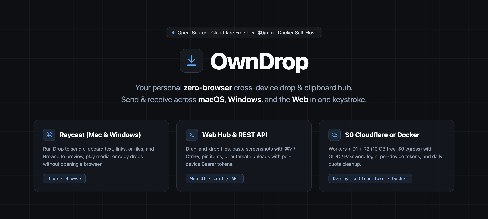
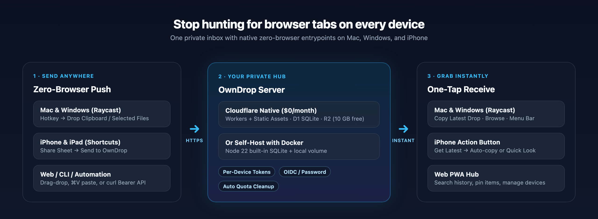
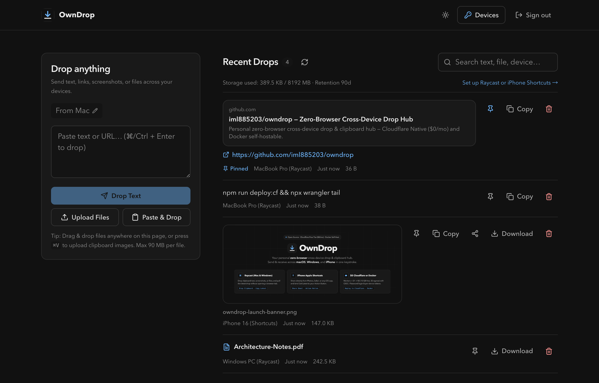
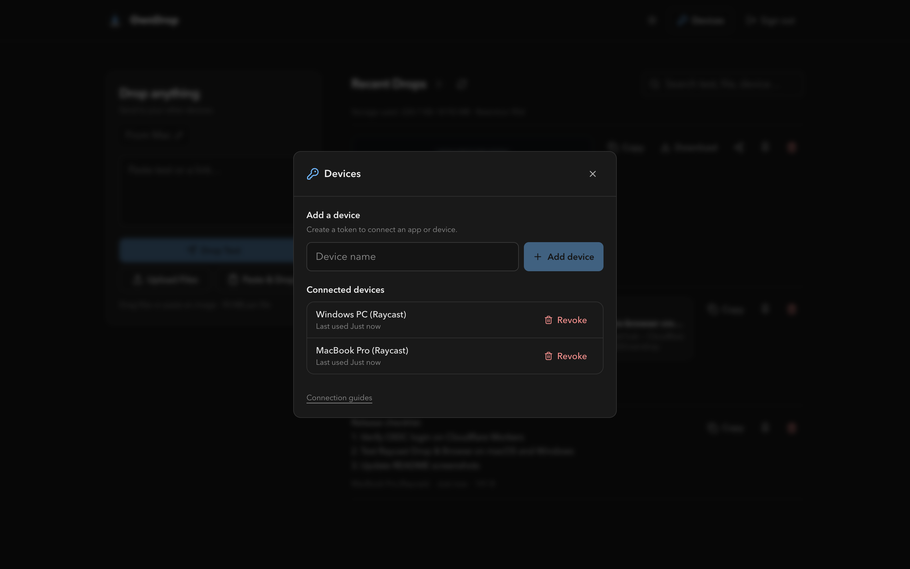
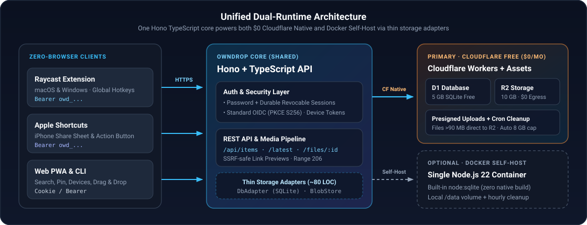

<div align="center">



<br />
<br />

[](LICENSE)
[](docs/cloudflare-deploy.md)
[](docs/self-hosting.md)
[](raycast/README.md)
[](docs/shortcuts.md)

<br />
<br />

[](https://deploy.workers.cloudflare.com/?url=https://github.com/iml885203/owndrop)

<br />

**English** · [繁體中文](README.zh-TW.md)

[Why OwnDrop](#-why-owndrop) · [Screenshots](#-interface--device-setup) · [Deploy Free on Cloudflare](#-option-1-deploy-free-on-cloudflare-0month) · [Docker Self-Host](#-option-2-self-host-with-docker) · [Connect Devices](#-connect-your-devices-zero-browser-workflow)

</div>

---

## 💡 Why OwnDrop?

Most cross-device file transfer tools force you to **open a browser tab on both devices** every single time you want to move a link, screenshot, or PDF.

**OwnDrop flips that model:**
- Your **Web UI** stays out of the way as a clean history & management hub.
- Your **daily transfers** happen directly inside native shortcuts on **macOS**, **Windows**, and **iPhone** — no hunting for browser tabs, no pairing codes, no third-party SaaS limits.
- Runs for **$0/month on Cloudflare's free tier** (Workers + D1 + R2) or in **one tiny Docker container** on your own server.

<p align="center">
  
</p>

---

## ✨ Highlights

| | Feature | Why it feels great |
| :---: | :--- | :--- |
| ⌨️ | **Raycast Extension (macOS & Windows)** | Use `Drop` to send clipboard content and `Browse` to preview, open, or copy your drops. |
| 📱 | **iPhone Apple Shortcuts** | Send from the native iOS Share Sheet; grab the newest drop from your Action Button or Control Center. |
| ☁️ | **Cloudflare Free Tier ($0/mo)** | Workers + Static Assets + D1 SQLite + R2 (10 GB free, **$0 egress**) + daily Cron quota cleanup. |
| 🐳 | **Docker Self-Hostable** | Exact same TypeScript/Hono codebase runs on Node 22 built-in `node:sqlite` (zero native builds). |
| 🔑 | **Per-Device Revocable Tokens** | Each device gets its own `owd_...` token & auto-tags items (`MacBook Pro`, `Windows PC`, `iPhone`). Revoke one device without breaking the rest. |
| 🔐 | **Password + Built-in OIDC** | Works out of the box with a single password, or connect **Pocket ID / Authentik / Authelia** via standard PKCE S256 OIDC. |
| 📦 | **Large Files (> 90 MB)** | Direct multipart uploads for small files & iOS Shortcuts, plus optional **R2 Presigned Direct Uploads** up to 512 MB+. |

---

## 🖼️ Interface & Device Setup

### Clean Workspace (Auto Dark & Light Mode)
Drag & drop files anywhere on the page, press `⌘V` / `Ctrl+V` to upload screenshots directly, pin important links, and search across text, filenames, and devices.

<p align="center">
  <picture>
    <source media="(prefers-color-scheme: dark)" srcset="docs/assets/web-workspace-dark.png" />
    <source media="(prefers-color-scheme: light)" srcset="docs/assets/web-workspace-light.png" />
    
  </picture>
</p>

### Built-in Device Manager & Zero-Browser Setup Guide
Click **Devices** to mint revocable per-device tokens and copy ready-to-paste setup snippets for Raycast, iPhone Shortcuts, and CLI.

<p align="center">
  
</p>

---

## 🚀 Quick Start (Pick One)

### ☁️ Option 1: Deploy Free on Cloudflare ($0/month)

Click the button below to fork OwnDrop, auto-provision your free **D1 database** and **R2 bucket**, run migrations, and go live in ~2 minutes — no VPS, no Docker, no Tunnel needed:

[](https://deploy.workers.cloudflare.com/?url=https://github.com/iml885203/owndrop)

After clicking **Deploy**, add two secrets in **Cloudflare Dashboard → Workers & Pages → owndrop → Settings → Variables and Secrets**:
- `OWNDROP_PASSWORD` — your login password
- `OWNDROP_SESSION_SECRET` — any random 32+ char string (`openssl rand -base64 48`)

<details>
<summary>Prefer deploying from CLI with Wrangler?</summary>

```bash
git clone https://github.com/iml885203/owndrop.git
cd owndrop
npm install

# 1. Build frontend & deploy (auto-provisions D1 + R2 and applies migrations)
npm run deploy:cf

# 2. Set your secrets
npx wrangler secret put OWNDROP_PASSWORD
npx wrangler secret put OWNDROP_SESSION_SECRET
# Optional: lock to a custom domain (defaults to your *.workers.dev origin)
# npx wrangler secret put OWNDROP_ORIGIN
```

</details>

Full walkthrough (including custom domains, Pocket ID OIDC, and >90 MB R2 direct uploads): **[`docs/cloudflare-deploy.md`](docs/cloudflare-deploy.md)**.

> **Free-tier safety net**: OwnDrop defaults to an 8 GB storage cap (`OWNDROP_MAX_STORAGE_MB=8192`) and runs a daily Cron job to evict old files automatically, keeping you comfortably inside Cloudflare R2's 10 GB free allowance.

---

### 🐳 Option 2: Self-Host with Docker

Full guide (including Pocket ID / Authentik OIDC setup): **[`docs/self-hosting.md`](docs/self-hosting.md)**.

```bash
git clone https://github.com/iml885203/owndrop.git
cd owndrop
cp .env.example .env
# Edit .env -> set OWNDROP_ORIGIN, OWNDROP_PASSWORD, OWNDROP_SESSION_SECRET

docker compose up -d --build
```

OwnDrop starts on `http://127.0.0.1:4180`. Put Caddy, Nginx, Traefik, or Cloudflare Tunnel in front of it.

---

## 🔌 Connect Your Devices (Zero-Browser Workflow)

1. Open your deployed OwnDrop web UI and sign in.
2. Click **Devices** → create a token for each device (`MacBook Pro`, `Windows PC`, `iPhone`).
3. Wire up your native clients once — enjoy lifetime zero-browser drops:

| Platform | Client | Daily Flow | Setup Guide |
| :--- | :--- | :--- | :--- |
| **macOS & Windows** | **Raycast Extension** | `Drop` automatically detects clipboard content; `Browse` previews text, links, and images, plays media, and copies content | [`raycast/README.md`](raycast/README.md) · [`Store Checklist`](docs/raycast-store.md) |
| **iPhone & iPad** | **Apple Shortcuts** | Native iOS **Share Sheet** (`Send to OwnDrop`) + **Action Button** (`Get Latest OwnDrop`) | [`docs/shortcuts.md`](docs/shortcuts.md) |
| **Terminal / Scripts** | **REST API (`curl`)** | Standard Bearer API (`POST /api/items/text`, `POST /api/items/file`, `GET /api/items/latest`) | [`docs/api.md`](docs/api.md) |

---

## 🏗️ Unified Architecture

One Hono TypeScript core powers both **Cloudflare Native** and **Docker Self-Host** through two thin storage adapters (~80 lines each):

<p align="center">
  
</p>

---

## 🛠️ Local Development & Testing

```bash
# Run unit & security test suite (Auth, OIDC PKCE, Tokens, SSRF, Range downloads, Cleanup)
npm test

# Typecheck server + web
npm run typecheck

# Run locally with Cloudflare Wrangler (local D1 + R2)
cp .dev.vars.example .dev.vars
npm run build:web && npm run db:migrate:local && npm run dev:cf

# Or run locally with Node 22 + local SQLite
OWNDROP_PASSWORD=dev-pass OWNDROP_SESSION_SECRET="$(openssl rand -hex 32)" npm run dev:node
```

## 📄 License

Released under the [MIT License](LICENSE).
