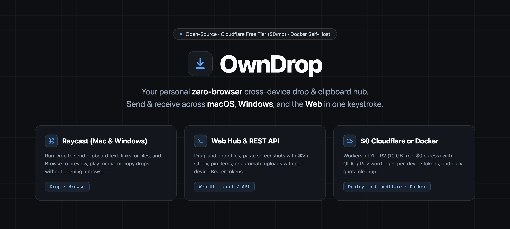
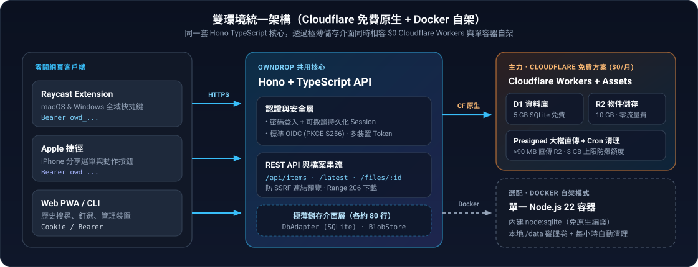

<div align="center">



<br />
<br />

[](LICENSE)
[](docs/cloudflare-deploy.md)
[](docs/self-hosting.md)
[](raycast/README.md)

<br />
<br />

[](https://deploy.workers.cloudflare.com/?url=https://github.com/iml885203/owndrop)

<br />

[English](README.md) · **繁體中文**

[為什麼做 OwnDrop](#-為什麼做-owndrop) · [介面預覽](#-介面與裝置設定預覽) · [免費部署到 Cloudflare](#-方案一免費部署到-cloudflare0月推薦) · [Docker 自架](#-方案二docker-compose-自架) · [零開網頁接線](#-連接你的裝置日常再也不用開網頁)

</div>

---

## 💡 為什麼做 OwnDrop？

大多數跨裝置傳輸工具，每次要傳一張截圖或一段連結，**兩台裝置都得先去找瀏覽器、開網頁、甚至打配對碼**，工作流直接被打斷。

**OwnDrop 把使用邏輯反過來：**
- **網頁介面**退居二線，負責歷史搜尋、釘選管理與新增裝置。
- 透過網頁或 **macOS 與 Windows 的 Raycast 擴充功能**，跨裝置傳送文字、連結、截圖與檔案。
- **免費跑在 Cloudflare（$0/月）**（Workers + D1 + R2），也支援 **Docker 單容器自架**。

<p align="center">
  
</p>

---

## ✨ 核心特色

| | 功能亮點 | 實際體驗 |
| :---: | :--- | :--- |
| ⌨️ | **跨平台 Raycast Extension（Mac & Windows）** | `Drop` 自動送出剪貼簿內容，`Browse` 預覽、開啟或複製內容。 |
| ☁️ | **Cloudflare 免費方案原生架構（$0/月）** | Workers + Static Assets + D1（SQLite）+ R2（10 GB 免費、**零流量費**），搭配每日 Cron 自動清理防爆額度。 |
| 🐳 | **同時支援 Docker 自架** | 同一套 Hono TypeScript 核心直接跑在 Node 22 內建 `node:sqlite`（無需原生 C++ 編譯）。 |
| 🔑 | **各客戶端獨立可撤銷 Token** | 每個連線客戶端有專屬 `owd_...` Token，項目會自動標記來源；撤銷單一 Token 不影響其他連線。 |
| 🔐 | **密碼登入 + 內建標準 OIDC** | 開箱即支援單一密碼登入，也可選配直連 **Pocket ID / Authentik / Authelia**（標準 PKCE S256 + 群組權限驗證）。 |
| 📦 | **突破大檔限制（> 90 MB）** | 小檔採單次上傳；設定 R2 S3 金鑰後自動啟用 **R2 Presigned 直傳**，大檔最高可傳 512 MB+。 |

---

## 🖼️ 介面與裝置設定預覽

### 簡潔清爽的暫存板（自動跟隨深／淺色主題）
支援全頁檔案拖放、`⌘V` / `Ctrl+V` 直接貼上剪貼簿圖片、連結預覽卡片、置頂釘選與即時關鍵字搜尋。

<p align="center">
  <picture>
    <source media="(prefers-color-scheme: dark)" srcset="docs/assets/web-workspace-dark.png" />
    <source media="(prefers-color-scheme: light)" srcset="docs/assets/web-workspace-light.png" />
    
  </picture>
</p>

### 內建「裝置管理」與「零開網頁設定精靈」
點右上角 **Devices** 即可發放／撤銷各裝置 Token，並複製 Raycast 或終端機所需的連線資料。

<p align="center">
  
</p>

---

## 🚀 3 分鐘快速部署（二選一）

### ☁️ 方案一：一鍵免費部署到 Cloudflare（$0/月，推薦）

點擊下方按鈕，Cloudflare 會自動 Fork 專案、自動建立免費的 **D1 資料庫** 與 **R2 儲存空間**、自動執行資料表遷移並部署上線（全程約 2 分鐘，完全不用開電腦跑 Docker）：

[](https://deploy.workers.cloudflare.com/?url=https://github.com/iml885203/owndrop)

部署完成後，到 **Cloudflare Dashboard → Workers & Pages → owndrop → Settings → Variables and Secrets** 加上這兩個 Secret 就立刻可用：
- `OWNDROP_PASSWORD`：你的登入密碼
- `OWNDROP_SESSION_SECRET`：任意 32 字元以上隨機字串（可用 `openssl rand -base64 48` 產生）

<details>
<summary>想改用本機 Wrangler CLI 部署？點此展開</summary>

```bash
git clone https://github.com/iml885203/owndrop.git
cd owndrop
npm install

# 1. 建置前端並部署（會自動建立 D1 / R2 並執行遷移）
npm run deploy:cf

# 2. 設定密鑰
npx wrangler secret put OWNDROP_PASSWORD
npx wrangler secret put OWNDROP_SESSION_SECRET
# 選填：綁定自訂網域時再設定（未設時自動使用 *.workers.dev）
# npx wrangler secret put OWNDROP_ORIGIN
```

</details>

完整設定說明（含自訂網域、Pocket ID OIDC 與 >90 MB 大檔直傳）：**[`docs/cloudflare-deploy.md`](docs/cloudflare-deploy.md)**。

> **免費額度安全防護**：預設總檔案上限設為 8 GB（`OWNDROP_MAX_STORAGE_MB=8192`），並透過每日 Cron 自動淘汰過期與最舊檔案，安心待在 R2 10 GB 免費額度內。

---

### 🐳 方案二：Docker Compose 自架

完整說明（含反向代理與 Pocket ID OIDC 串接）見 **[`docs/self-hosting.md`](docs/self-hosting.md)**。

```bash
git clone https://github.com/iml885203/owndrop.git
cd owndrop
cp .env.example .env
# 編輯 .env，填入 OWNDROP_ORIGIN、OWNDROP_PASSWORD、OWNDROP_SESSION_SECRET

docker compose up -d --build
```

容器預設監聽 `http://127.0.0.1:4180`，前面接 Caddy、Nginx 或 Cloudflare Tunnel 即可使用。

---

## 🔌 連接你的裝置（日常再也不用開網頁）

1. 登入 OwnDrop 網頁版，點右上角 **Devices**。
2. 為要連線的客戶端建立專屬 Token，例如 Raycast 或自動化指令碼。
3. 各平台一次性接好線，之後完全免開網頁：

| 平台 | 入口工具 | 日常操作 | 設定指南 |
| :--- | :--- | :--- | :--- |
| **macOS & Windows** | **Raycast Extension** | `Drop` 自動判斷剪貼簿內容；`Browse` 預覽文字、連結與圖片，播放影音並複製內容 | [`raycast/README.md`](raycast/README.md) · [`上架清單`](docs/raycast-store.md) |
| **終端機 / 自動化** | **REST API (`curl`)** | 標準 Bearer API（`POST /api/items/text`、`POST /api/items/file`、`GET /api/items/latest`） | [`docs/api.md`](docs/api.md) |

---

## 🏗️ 雙環境統一架構

核心 API 採用 **Hono + TypeScript**，透過兩層極薄的儲存介面同時相容 **Cloudflare Native** 與 **Docker Self-Host**：

<p align="center">
  
</p>

---

## 📄 授權條款

採用 [MIT License](LICENSE) 開源釋出。
